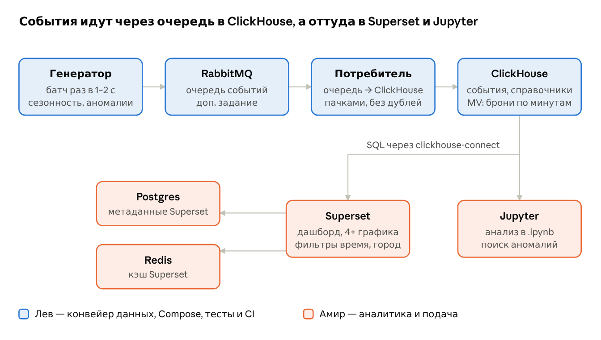
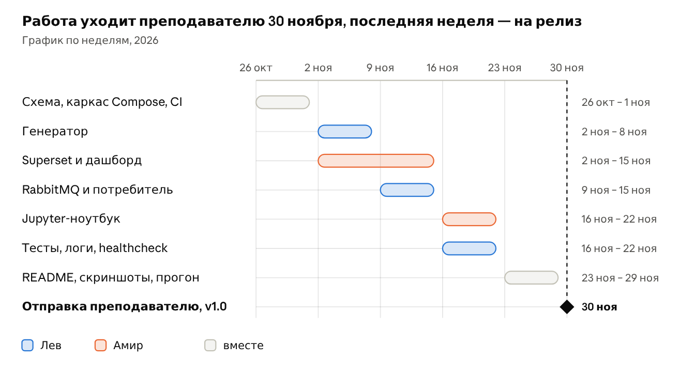

# Аналитика бронирований

## О проекте

Проект по предмету «Аналитика данных»: делаем вдвоём систему потоковой аналитики бронирований: генератор событий → RabbitMQ → ClickHouse → Superset и Jupyter. Вся система поднимается одной командой `docker compose up`. Цель — отправить работу преподавателю к 30 ноября, чтобы до зачётной недели успеть исправить замечания.

**Предметная область — вариант 6 «свой»: бронирование ресурсов.** Переговорки, коворкинги и залы в нескольких городах. Пользователи бронируют их на несколько часов, иногда отменяют. Вариант нужно согласовать с преподавателем. Если не согласует, берём вариант 5 «Такси»: архитектура и разделение работы останутся теми же.

**Что анализируем:** когда и где бронируют, какие типы ресурсов приносят выручку, какая доля броней отменяется, где возникают аномалии.

**Чем это лучше готовых вариантов:** у данных естественная суточная и недельная сезонность (днём и в будни броней больше), а к ним — реалистичные аномалии (всплеск отмен, бронь по завышенной цене). Найти их потом в Jupyter и Superset — интересная задача.

Полное задание и чек-лист приёмки — в файлах «Задание.pdf» и «План приёмки.pdf».

## Архитектура

Все восемь сервисов описаны в одном `docker-compose.yml`. Генератор стартует только после того, как healthcheck ClickHouse и RabbitMQ стал зелёным (`depends_on: condition: service_healthy`).



Цвет показывает, кто за что отвечает. Граница зон проходит по ClickHouse: схему делаем вместе, потом каждый работает по свою сторону от неё.

## Схема данных — общий контракт

Схему фиксируем вместе в первую неделю. После этого таблицы меняются только через PR с ревью обоих: на них одновременно опираются генератор, Superset и Jupyter. Ниже черновик для обсуждения.

| Таблица | Движок и ключи | Поля |
| --- | --- | --- |
| `users` (справочник) | `ReplacingMergeTree`, `ORDER BY user_id` | `user_id`, `name`, `city`, `segment` (студент / фрилансер / компания), `registered_at` |
| `resources` (справочник) | `ReplacingMergeTree`, `ORDER BY resource_id` | `resource_id`, `name`, `resource_type` (переговорка / рабочее место / зал / студия), `city`, `capacity`, `price_per_hour` |
| `booking_events` (события) | `MergeTree`, `PARTITION BY toYYYYMM(event_time)`, `ORDER BY (resource_id, event_time)` | `event_time`, `event_type` (created / cancelled / completed), `booking_id`, `user_id`, `resource_id`, `resource_type`, `city`, `starts_at`, `duration_h`, `price`, `lead_time_h` |
| `bookings_per_minute` (агрегат) | `SummingMergeTree`, `ORDER BY (minute, resource_type, city, event_type)` | `minute`, `resource_type`, `city`, `event_type`, `events`, `revenue` |
| `bookings_per_minute_mv` | Materialized View: `booking_events` → `bookings_per_minute` | считает агрегаты при каждой вставке |

**Договорённости:**

- **Тип ресурса и город дублируются в `booking_events`.** Для ClickHouse это нормально: MV и фильтры Superset работают без JOIN. Связь со справочниками — по `user_id` и `resource_id`.
- **Размерности:** `resource_type`, `city`, `event_type`, `segment` (все `LowCardinality(String)`). **Метрики:** `price`, `duration_h`, `lead_time_h`.
- **Время** — `DateTime('Asia/Vladivostok')`, чтобы суточная сезонность была видна без пересчёта поясов.
- **Читаем агрегат только через `sum(...) GROUP BY`.** `SummingMergeTree` складывает строки в фоне, не сразу, и без агрегации цифры в Superset будут дробиться.
- **Аномалии в данных не помечаем.** Их нужно найти анализом. Генератор пишет в лог, когда и какую аномалию он добавил, — по логу проверяем, что ноутбук нашёл нужное.
- **История за 30 дней.** При первом запуске генератор дозаписывает её батчами, потом пишет в реальном времени (батч раз в 1–2 с). Иначе суточную сезонность на защите показать не получится.
- **Данные для старта.** Пока генератора нет, Superset и ноутбук строятся на тестовых данных: скрипт `sql/seed_dev.sql` (`INSERT … SELECT … FROM numbers(100000)`).

## Разделение ролей

Работа делится на две зоны. Лев отвечает за то, как данные попадают в ClickHouse, Амир — за то, как они анализируются и показываются. Владелец зоны пишет код и отвечает за её пункты чек-листа, второй делает ревью и должен понимать её на защите.

### Лев — конвейер данных

- [ ] Каркас Docker Compose: все сервисы, именованные volumes, `.env.example`
- [ ] CI с первой недели: ruff (линтер и форматирование) и pyright на каждый PR в `main`; GitHub Actions или GitLab CI — там, где будет репозиторий
- [ ] ClickHouse: init-скрипты со схемой и MV, healthcheck
- [ ] Генератор: справочники, события с суточной и недельной сезонностью, трендом и аномалиями, история за 30 дней
- [ ] Генератор: настройки через env (интервал, интенсивность, seed), retry с backoff, graceful shutdown, логирование
- [ ] RabbitMQ и потребитель: генератор → очередь → вставка пачками в ClickHouse, без дублей при повторной доставке (задание «со звёздочкой»)
- [ ] Тесты на pytest в CI: днём событий больше, чем ночью; размер батча; retry при недоступном ClickHouse (через мок); повторная доставка пачки не создаёт дублей (на настоящем ClickHouse в контейнере CI)

### Амир — аналитика и подача

- [ ] Superset, Postgres (метабаза) и Redis (кэш) в Compose
- [ ] Автоматический старт Superset: миграции, админ, подключение к ClickHouse (clickhouse-connect), импорт дашборда
- [ ] Дашборд: временной ряд по MV, разбивка по типам ресурсов, топ-10 ресурсов по выручке, KPI (броней за час или доля отмен), фильтры по времени и городу
- [ ] Jupyter в контейнере, подключение к ClickHouse
- [ ] Ноутбук: 3+ аналитических запроса, 2+ графика (суточная динамика, распределение по категориям), выводы и найденные аномалии
- [ ] Скриншоты дашборда и графиков для README

### Вместе

- [ ] Схема ClickHouse и набор аналитических вопросов (что ищем в данных)
- [ ] README: описание, схема архитектуры, запуск, порты, логины и пароли по умолчанию
- [ ] Прогон на чистой машине: `git clone` → `docker compose up` → всё работает; `down` → `up` → данные на месте
- [ ] Разбор зон друг для друга (по 15 минут) и репетиция защиты

Возможный вариант: SQL-запросы для ноутбука пишет Лев, графики и выводы делает Амир. Решаем в первую неделю.

## График

На работу есть пять недель, с 26 октября по 29 ноября. 30 ноября отправляем тег `v1.0`, декабрь остаётся на правки по замечаниям (обычные PR, затем тег `v1.1`).



Первая неделя общая и блокирует остальные: пока схема не в `main`, никто не может начать свою зону. Дальше зоны идут параллельно: Superset строится на `seed_dev.sql`, не дожидаясь генератора. Именно на него заложены две недели: автоматический импорт дашборда — самая непредсказуемая часть задания.

## Как работаем

Работаем по GitHub Flow: одна постоянная ветка `main`, на каждую задачу — короткая ветка и PR. В `main` напрямую не пушим: только через PR (merge request) с ревью второго. Так история коммитов покажет преподавателю поэтапную работу двух авторов, а ревью поможет разобраться в чужой зоне.

**Защита `main`** настраивается в репозитории один раз (branch protection в GitHub, protected branch в GitLab): слияние только через PR, нужны зелёный CI и одобрение второго участника. В `main` всегда лежит рабочая версия: `docker compose up` поднимает систему в любой момент.

1. **Старт задачи:** `git switch main && git pull`, затем `git switch -c feature/<задача>` (для исправлений — `fix/<что>`). Ветка живёт не дольше 1–3 дней: чем короче ветка, тем меньше конфликтов.
2. **Коммиты маленькие и понятные:** `feat(generator): суточная сезонность событий`. Не склеивать всё в один коммит в конце недели.
3. **PR в `main` → CI зелёный и ревью в течение суток → merge без squash** (merge-коммит или rebase, иначе покоммитная история пропадёт). Ревьюер запускает ветку у себя, а не только читает diff, и задаёт вопросы в комментариях: те же вопросы может задать преподаватель. После слияния ветку удаляем.
4. **Сдача:** README и скриншоты — обычным PR → прогон `main` на чистой машине → тег `v1.0` (`git tag -a v1.0 -m "Сдача"`, `git push origin v1.0`). Преподавателю отправляем ссылку на тег. Правки по замечаниям — обычные PR, после них тег `v1.1`.
5. **Секреты не коммитим.** Все пароли и настройки — в `.env` (он в `.gitignore`), в репозитории только `.env.example`. Новая переменная в коде → сразу строка в `.env.example`.
6. **Синк 15 минут раз в неделю** (например, в воскресенье вечером): что сделано, что блокирует, что дальше. В остальное время — чат.

**Структура репозитория:**

```
docker-compose.yml   .env.example   README.md
clickhouse/init/     # SQL: таблицы, MV                          (Лев)
generator/           # Python-сервис генерации                   (Лев)
consumer/            # очередь → ClickHouse                      (Лев)
superset/            # конфиг, init-скрипт, экспорт дашборда     (Амир)
jupyter/notebooks/   # .ipynb с анализом                         (Амир)
sql/                 # seed_dev.sql, аналитические запросы
docs/img/            # схема и скриншоты для README
tests/               # pytest для генератора и потребителя       (Лев)
.github/workflows/   # CI: ruff → pyright → pytest (или .gitlab-ci.yml) (Лев)
```

## Чек-лист приёмки по владельцам

Каждый раздел чек-листа преподавателя закреплён за одним владельцем. Перед тегом `v1.0` владелец проходит свои пункты, а второй участник перепроверяет их.

| Раздел чек-листа | Что проверяют | Владелец |
| --- | --- | --- |
| 0. Допуск | письмо до зачётной недели, открытый репозиторий, поэтапные коммиты, README, `.env.example` | вместе |
| 1. Репозиторий и документация | описание, схема архитектуры, запуск, порты и пароли, скриншоты, нет захардкоженных паролей | вместе (скриншоты — Амир) |
| 2. Docker Compose | все сервисы одной командой, volumes, healthcheck, порядок старта, данные после `down` / `up` | Лев |
| 3. Генератор | автостарт, батчи, 2+ связанные таблицы, 4+ полей, сезонность, аномалии, env, retry и graceful shutdown | Лев |
| 4. ClickHouse | init-скрипты, движки, партиции, `ORDER BY`, MV наполняется, volume | Лев (схема — вместе) |
| 5. Superset | автоинициализация, 4+ визуализации, одна из них на MV, работающий фильтр, данные обновляются | Амир |
| 6. Jupyter | запуск из контейнера, 3+ запроса, 2+ графика, выводы и аномалии | Амир |
| 7. Дополнительно (на «отлично») | брокер RabbitMQ, аккуратная структура, линтер, логирование; сверх чек-листа — тесты и CI | Лев (логирование — каждый в своих сервисах) |

## Защита и открытые вопросы

На защиту дают 5–10 минут. Показываем в порядке, который требует преподаватель. Каждый ведёт свою часть, но должен суметь ответить и про чужую.

1. `docker compose up` одной командой, все сервисы healthy — Лев
2. Логи генератора и потребителя, `count()` в `booking_events` растёт, в MV появляются новые минуты — Лев
3. Дашборд Superset: фильтр по городу и времени, график по MV обновляется — Амир
4. Ноутбук: сезонность и найденные аномалии, сверка с логом генератора — Амир
5. `docker compose down` → `up` → данные и дашборд на месте — Лев

Репетируем с таймером хотя бы один раз. Первый запуск Superset и скачивание образов занимают минуты, поэтому образы скачиваем заранее (`docker compose pull`).

**Вопросы, которые надо закрыть в первую неделю:**

- [ ] Согласовать с преподавателем вариант 6 «Бронирование ресурсов» и работу вдвоём (письмо на goncharuk.dm@dvfu.ru)
- [ ] Узнать точные даты зачётной недели и при необходимости сдвинуть срок отправки (сейчас — 30 ноября)
- [ ] Решить, где репозиторий: GitHub-аккаунт Льва заблокирован, поэтому либо GitLab, либо GitHub Амира
- [ ] Решить, кто пишет SQL-запросы для ноутбука (см. Разделение ролей)
