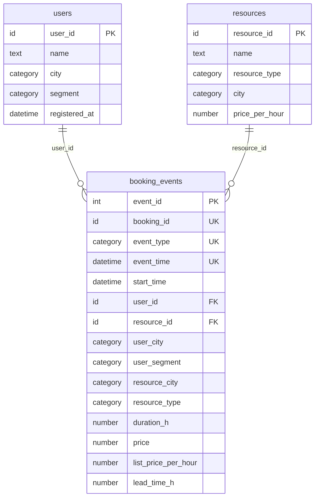

# Предметная область: бронирование ресурсов

Вариант 6 «свой». Система фиксирует бронирование ресурсов (переговорки, рабочие места, залы, студии) в нескольких городах. Пользователи бронируют ресурсы на несколько часов, часть броней отменяется. Анализируется: когда и где бронируют, какие типы ресурсов приносят выручку, какая доля броней отменяется, где возникают аномалии (всплеск отмен, бронь по завышенной цене).

Данные поступают потоком событий жизненного цикла брони: `created` (создана), `cancelled` (отменена), `completed` (состоялась). Пайплайн: генератор → RabbitMQ → консьюмер → ClickHouse → Superset и Jupyter.

**Принцип модели.** В факте хранятся ключи и числовые показатели. Текстовые атрибуты (город, сегмент, тип ресурса) денормализованы в факт строками `LowCardinality(String)`, поэтому запросы и MV работают без JOIN. Персональные данные (имя) есть только в справочнике `users`. Время хранится как `DateTime('Asia/Vladivostok')`.

## Справочники

Справочники статичные: генератор создаёт их один раз и не меняет. Они загружаются раньше событий. Движок обоих: `ReplacingMergeTree()`, читать с `FINAL`.

| `users` | Тип | | `resources` | Тип |
| --- | --- | --- | --- | --- |
| `user_id` (ключ, `ORDER BY`) | `UInt64` | | `resource_id` (ключ, `ORDER BY`) | `UInt64` |
| `name` | `String` | | `name` | `String` |
| `city` | `LowCardinality(String)` | | `resource_type` | `LowCardinality(String)` |
| `segment` | `LowCardinality(String)` | | `city` | `LowCardinality(String)` |
| `registered_at` | `DateTime('Asia/Vladivostok')` | | `price_per_hour` | `Decimal(18,2)` |

## Таблица фактов `booking_events`

Движок `MergeTree`, `PARTITION BY toYYYYMM(event_time)`, `ORDER BY (booking_id, event_type, event_time)`.

| Поле | Тип | Смысл |
| --- | --- | --- |
| `event_id` | `UInt64` | `cityHash64(booking_id, event_type, event_time)` |
| `booking_id` | `UInt64` | бронь; часть бизнес-ключа |
| `event_type` | `LowCardinality(String)` | `created` / `cancelled` / `completed`; часть бизнес-ключа |
| `event_time` | `DateTime('Asia/Vladivostok')` | когда произошло событие; часть бизнес-ключа |
| `start_time` | `DateTime('Asia/Vladivostok')` | начало забронированного интервала |
| `user_id`, `resource_id` | `UInt64` | внешние ключи на справочники |
| `user_city`, `user_segment` | `LowCardinality(String)` | копия из `users` на момент загрузки |
| `resource_city`, `resource_type` | `LowCardinality(String)` | копия из `resources` на момент загрузки |
| `duration_h` | `UInt16` | длительность в целых часах, ≥ 1 |
| `price` | `Decimal(18,2)` | стоимость брони целиком, ≥ 0 |
| `list_price_per_hour` | `Decimal(18,2)` | цена за час по прейскуранту (копия `resources.price_per_hour`), ≥ 0 |
| `lead_time_h` | `Float64` | у `created`: `start_time − event_time` в часах; у остальных `0` |

`Nullable` не используется: пустых значений в факте нет.

`price` и `duration_h` относятся к брони, а не к событию, поэтому повторяются у событий одной брони. Суммировать `price` по всем событиям нельзя: выручка считается только по `completed`.

## Зерно и ключ

- **Одна строка факта — одно событие жизненного цикла брони.** Строки только добавляются.
- **Бизнес-ключ события:** (`booking_id`, `event_type`, `event_time`). Пара (`booking_id`, `event_type`) не подходит: она ломается при отмене и повторном создании брони.
- **Дубли отсекаются до вставки в факт.** MV срабатывают на вставке и потом не пересчитываются, поэтому дубль, схлопнутый после вставки, уже попал бы в агрегаты.
- Правки событий задним числом в v1.0 не поддерживаются: строка с тем же ключом и другими полями отбрасывается, остаётся первая версия.
- `completed` — конечное состояние: у брони не больше одного `completed`, иначе удвоилась бы выручка.
- Нарушенный порядок событий загрузку не блокирует, его находят отчётом.
- Счётчики `events_*` считают события, а не уникальные брони.

## Принципы загрузки

Консьюмер обрабатывает сообщения до вставки в факт:

- **Событие в очереди несёт только ключи, времена и меры.** Денормализованные поля, `list_price_per_hour` и `lead_time_h` подставляет и считает консьюмер.
- **Событие с неизвестным `user_id`, `resource_id` или `event_type` в факт не попадает.**
- **Числовые ограничения проверяются на сырых значениях** до приведения к типам ClickHouse: `UInt16` не выражает отрицательное, а дробное пришлось бы округлять — иначе причина `constraint` не попадёт в журнал.
- **Отбраковка:** все отброшенные сообщения пишутся в `booking_rejects` с причиной.

## Журнал отбраковки `booking_rejects`

Поля: `rejected_at`, `event_time`, `booking_id`, `event_type`, `reason`, `payload` (исходное сообщение целиком, JSON), `count` (`UInt64`, число повторов этой отбраковки). Движок `SummingMergeTree()`, `PARTITION BY toYYYYMM(rejected_at)`, `ORDER BY (cityHash64(payload), reason)`. Читать с `FINAL`, общее число отбракованных — `sum(count)`.

Причины (`reason`): `malformed` (JSON не разобрался), `empty_value`, `constraint` (нарушено числовое ограничение), `unknown_key`, `duplicate`, `mismatch` (тот же ключ, другие поля), `repeat_completed`.

Ключ сортировки построен по содержимому сообщения: у сообщения с битым JSON нет бизнес-полей, и по ним все такие строки схлопнулись бы в одну. У `malformed` поля `event_time`, `booking_id`, `event_type` принимают значения по умолчанию. Читать журнал с `FINAL`; число уникальных отбраковок — `count()`, общее число отбракованных — `sum(count)`.

## Агрегаты и MV

Две агрегатные таблицы на `SummingMergeTree`, наполняются MV при вставке в факт. MV читают только факт, JOIN нет. Читать агрегаты только через `sum(...) GROUP BY`: строки складываются в фоне. `minute` в минутной MV — `toStartOfMinute(event_time)`.

**`bookings_per_minute`**: ключ `(minute, resource_city, resource_type, user_city, user_segment)`. Поля: `events_created`, `events_cancelled`, `events_completed` (число событий каждого типа), `revenue` (сумма `price` по событиям `completed`) и `lead_negative` (число событий `created` с отрицательным `lead_time_h`). Срез по меньшему набору измерений (например, город и тип ресурса) получается суммированием по ним.

**`bookings_per_resource_day`**: ключ `(day, resource_id, resource_city)`, где `day = toDate(event_time)`. Поля: `events_completed` и `revenue` (сумма `price` по событиям `completed`).

Типы агрегатов: `minute` — `DateTime('Asia/Vladivostok')`, `day` — `Date`, счётчики — `UInt64`, `revenue` — `Decimal(18,2)`.

Доля отмен по минутам не считается: отмена происходит позже создания, и отношение может превысить 1. Её считают по часам и дням или по когорте броней запросом к факту. Сезонность «на когда бронируют» (час дня, день недели) считается по `start_time` запросом к факту.

## Аномалии

Аномалии загрузку не блокируют, их находят запросами и сверяют с логом генератора, который пишет, когда и какую аномалию добавил:

- бронь создана после начала интервала (`lead_time_h < 0` у `created`), считается счётчиком `lead_negative`;
- всплеск отмен: число отмен по часам против обычного уровня;
- завышенная цена: `price` против `list_price_per_hour * duration_h`;
- нарушенный порядок событий брони (`completed` или `cancelled` раньше `created`).

## Схема Star Schema

Центральная таблица `booking_events`, вокруг неё справочники `users` и `resources`. Агрегаты и журнал отбраковки в звезду не входят.

